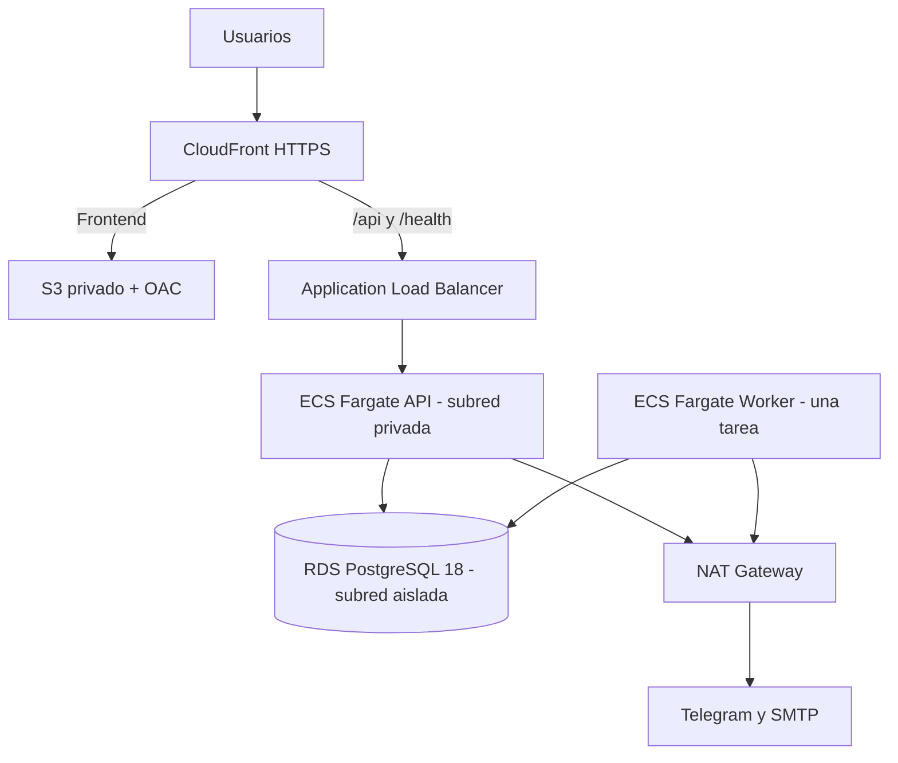

# SCCVI - Infraestructura AWS con Terraform

## Objetivo

Esta carpeta define infraestructura como código para desplegar SCCVI en AWS. La configuración no despliega nada hasta ejecutar explícitamente `terraform apply`.

## Arquitectura prevista

- VPC con dos o más zonas de disponibilidad.
- ALB público, accesible únicamente desde los rangos administrados de CloudFront.
- ECS Fargate en subredes privadas: un servicio API y un servicio worker separado.
- El worker queda limitado a una tarea activa para evitar dos procesos de long polling de Telegram.
- RDS PostgreSQL 18.6 en subredes aisladas, sin IP pública, cifrado, SSL forzado, backups y Multi-AZ.
- ECR para una misma imagen Docker que ejecuta `src/server.js` o `src/worker.js` según el task definition.
- S3 privado y CloudFront con Origin Access Control (OAC) para el frontend.
- CloudFront enruta `/api/*` y `/health/*` hacia el ALB.
- Secrets Manager para contraseña del usuario de aplicación PostgreSQL, JWT, SMTP y token Telegram; RDS administra por separado la contraseña maestra.
- CloudWatch Logs para API y worker.
- Un bucket S3 versionado y con cifrado para el estado remoto y locking nativo de Terraform.

## Flujo de arquitectura



## Estructura

- `infra/terraform/bootstrap-state`: crea el bucket privado donde se alojará el estado Terraform.
- `infra/terraform/stack`: define VPC, redes, RDS, ECS, ALB, ECR, S3, CloudFront, ACM, Route 53 y Secrets Manager.

## Requisitos locales

- Terraform CLI 1.10 o superior.
- AWS CLI v2.
- Docker Desktop con integración Linux/WSL2 para construir la imagen Node.
- Un usuario/rol AWS con permisos suficientes para crear VPC, EC2, ECS, ECR, IAM, RDS, Secrets Manager, CloudWatch, S3, CloudFront, ACM y Route 53.
- Para el entorno `prod`, una zona pública de Route 53 y dos nombres DNS: por ejemplo `app.midominio.com` y `api.midominio.com`.

No compartas claves de AWS, contraseñas, tokens del bot ni claves SMTP en el repositorio o en el chat. Usa AWS IAM Identity Center/SSO y Secrets Manager.

## Paso A - autenticar AWS sin exponer credenciales

Configura un perfil SSO de AWS CLI siguiendo el procedimiento de tu organización. Después inicia sesión:

```powershell
aws sso login --profile sccvi
aws sts get-caller-identity --profile sccvi
```

Si el perfil tiene otro nombre, ajusta `aws_profile` en `terraform.tfvars` o deja la variable vacía y usa `AWS_PROFILE`.

## Paso B - crear el bucket de estado remoto

Este módulo usa estado local únicamente para crear el bucket que guardará el estado de la infraestructura. El bucket creado tiene versionado, cifrado AES-256, bloqueo de acceso público y política que exige HTTPS.

```powershell
cd infra/terraform/bootstrap-state
terraform fmt -recursive
terraform init -backend=false
terraform validate
terraform plan -out bootstrap.tfplan
```

Revisa el plan y su región/nombre. Solo después de aprobar el recurso de almacenamiento del estado:

```powershell
terraform apply bootstrap.tfplan
terraform output terraform_state_bucket
terraform output -raw backend_hcl_example
```

La aplicación de este módulo crea un bucket S3 y puede generar cargos pequeños de almacenamiento/solicitudes. No lo ejecutes sin revisar el plan.

## Paso C - configurar backend remoto

En `infra/terraform/stack`, copia `backend.hcl.example` a `backend.hcl`. Coloca el nombre real del bucket obtenido en el paso B. Este archivo está ignorado por Git.

```powershell
cd ..\stack
Copy-Item backend.hcl.example backend.hcl
notepad backend.hcl
terraform init -backend-config=backend.hcl
```

El backend usa `use_lockfile = true` para impedir que dos operadores modifiquen el mismo estado simultáneamente. El bucket de estado debe permanecer privado y con versionado.

## Paso D - configurar valores no secretos

Copia `terraform.tfvars.example` a `terraform.tfvars` y sustituye:

- `aws_profile` por tu perfil, si corresponde.
- `frontend_domain_name` y `api_domain_name` por nombres que controles.
- `route53_zone_id` por el ID real de la zona pública de Route 53.
- `smtp_user` por la dirección de Gmail configurada para la aplicación.
- Revisa región, clase RDS, Multi-AZ, número de NAT y límites de tareas.

`terraform.tfvars` está ignorado por Git. No coloques secretos aquí.

## Paso E - validar y revisar plan (sin crear infraestructura)

```powershell
terraform fmt -recursive
terraform validate
terraform plan -var-file=terraform.tfvars -out sccvi.tfplan
terraform show sccvi.tfplan
```

`terraform validate` revisa sintaxis y consistencia. `terraform plan` además consulta AWS y muestra los recursos/costos potenciales que se crearían, pero no los crea.

**No ejecutes `terraform apply` todavía.** Antes se deben revisar el costo estimado en AWS Pricing Calculator, el dominio, el presupuesto, las cuotas de la región, las migraciones de PostgreSQL y el procedimiento de restauración.

## Paso F - secuencia de despliegue posterior (no ejecutar en esta fase)

Cuando la infraestructura y el plan hayan sido aprobados:

1. Aplicar infraestructura base con `api_desired_count=0` y `worker_desired_count=0`.
2. Cargar los valores de `JWT_SECRET`, `SMTP_PASS` y `TELEGRAM_BOT_TOKEN` en los Secrets Manager ARNs emitidos por Terraform.
3. Construir la imagen de `backend/Dockerfile` y subir la etiqueta inmutable definida en `container_image_tag` al repositorio ECR.
4. Ejecutar la fase de migración/restauración PostgreSQL. En esa fase se creará el usuario de aplicación `sccvi_app`, se asignarán permisos al esquema y se guardará su contraseña en `db-app-password`. El secreto maestro administrado por RDS se reservará para tareas administrativas/migración, no para la aplicación.
5. Publicar `frontend/dist` en el bucket S3 y configurar invalidación de CloudFront.
6. Cambiar `api_desired_count` a 1 o 2 y `worker_desired_count` a 1; aplicar el cambio con un plan revisado.
7. Verificar `/health/ready`, login, reportes, carnet, correo y Telegram.

La imagen del backend se reutiliza para ambos servicios: el API ejecuta `node src/server.js` y el worker `node src/worker.js`. El worker se mantiene a una sola réplica por el polling de Telegram.

## Costos y decisiones deliberadas

Esta arquitectura no es gratuita. NAT Gateway por AZ, ALB, ECS/Fargate, RDS Multi-AZ, CloudFront, ECR, Secrets Manager y logs pueden generar cargos. `single_nat_gateway=false` y `db_multi_az=true` priorizan disponibilidad sobre costo. Cambiarlos reduce costos, pero introduce puntos únicos de fallo o menor disponibilidad.

El bucket de frontend es privado; CloudFront accede por OAC. No se habilita hosting web público directamente desde S3.

Para evitar arrancar tareas con una imagen inexistente o secretos sin cargar, los servicios ECS quedan con desired count 0 por defecto. No aumentes estos valores hasta terminar las etapas indicadas.

## Comandos de formato/validación

Ejecuta `terraform fmt -recursive` en ambos módulos. Para validar sin configurar el backend remoto del stack:

```powershell
cd infra/terraform/stack
terraform init -backend=false
terraform validate
```

La validación local no garantiza que todos los recursos estén disponibles en tu cuenta/región. La comprobación de disponibilidad y permisos llega con `terraform plan` usando la sesión AWS correspondiente.
